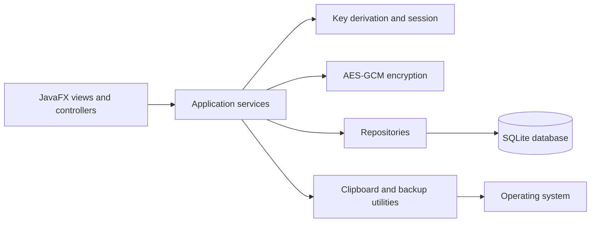

# Architecture

VaultX uses a small layered architecture. JavaFX views translate user actions into service calls. Services validate inputs and coordinate security and business rules. Repositories perform parameterized SQLite operations. `EncryptionService` encrypts each credential payload before it reaches a repository; the repository never receives a plaintext password.

## Responsibilities

- `view`: JavaFX navigation, screen composition, validation feedback, and reusable controls.
- `service`: authentication, credential lifecycle, generation, strength estimation, and backup operations.
- `security`: PBKDF2, secure randomness, authenticated encryption, and session key lifetime.
- `repository`: prepared SQL statements and database transaction boundaries.
- `database`: path selection, connection configuration, and schema initialization.
- `model`: immutable credential metadata and settings objects; credential password arrays are defensively copied and cleared where practical.
- `util`: input validation and ownership-aware clipboard clearing.

## Data flow

1. Setup derives 64 bytes from the master password and a random 16-byte salt. The first half is stored as the authentication verifier; the second half exists only in the unlocked session as the AES key.
2. Credential fields are serialized to a versioned binary payload, encrypted using AES-256-GCM with a fresh 12-byte nonce, and stored as nonce plus ciphertext/tag.
3. On unlock, PBKDF2 derives both halves again. A constant-time comparison checks the verifier before the session receives the encryption key.
4. On master-password change, the application derives a new key, re-encrypts every existing payload, and atomically commits the replacement records and new verifier metadata in one SQLite transaction.
5. A backup is exported only after unlock. A separate password and salt derive an independent AES-GCM key; the authenticated backup envelope is validated completely before import changes the database.

## Platform and UI

The design targets desktop operation with a collapsible-feeling fixed navigation rail and a flexible content pane. The minimum window is large enough for the primary task screens; tables and forms scroll rather than clipping at smaller sizes. JavaFX theme tokens are centralized in CSS. The packaged Windows runtime is built on a Windows GitHub Actions runner using `jpackage`.

## Error handling and concurrency

Database and KDF work that could block interaction runs in JavaFX background tasks. UI updates return to the JavaFX application thread. Services throw application exceptions with safe user-facing messages; logs contain operation context but never passwords, keys, decrypted payloads, or clipboard contents.

## Academic concepts demonstrated

Encapsulation in models and session state, interfaces between service/repository responsibilities, composition for screen construction, exception handling, generic Java collections, streams for sorting/filtering, JavaFX properties and lambdas, JDBC, file I/O, and JavaFX background tasks.
