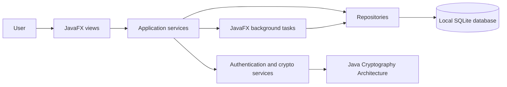
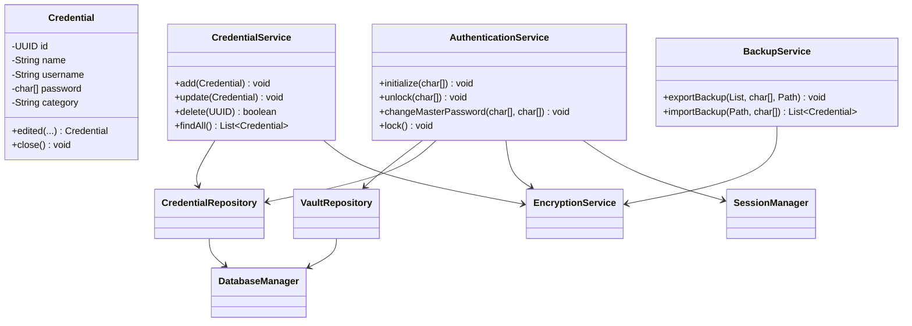
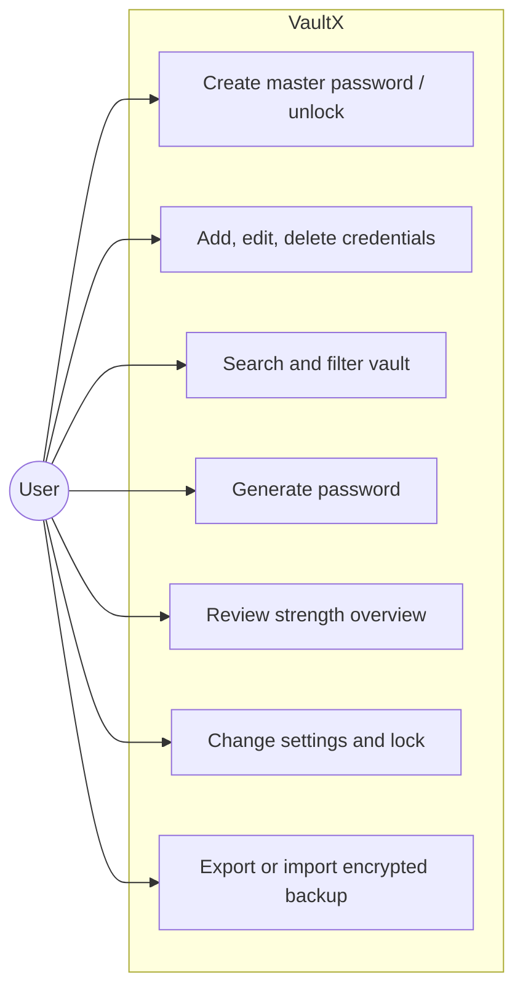
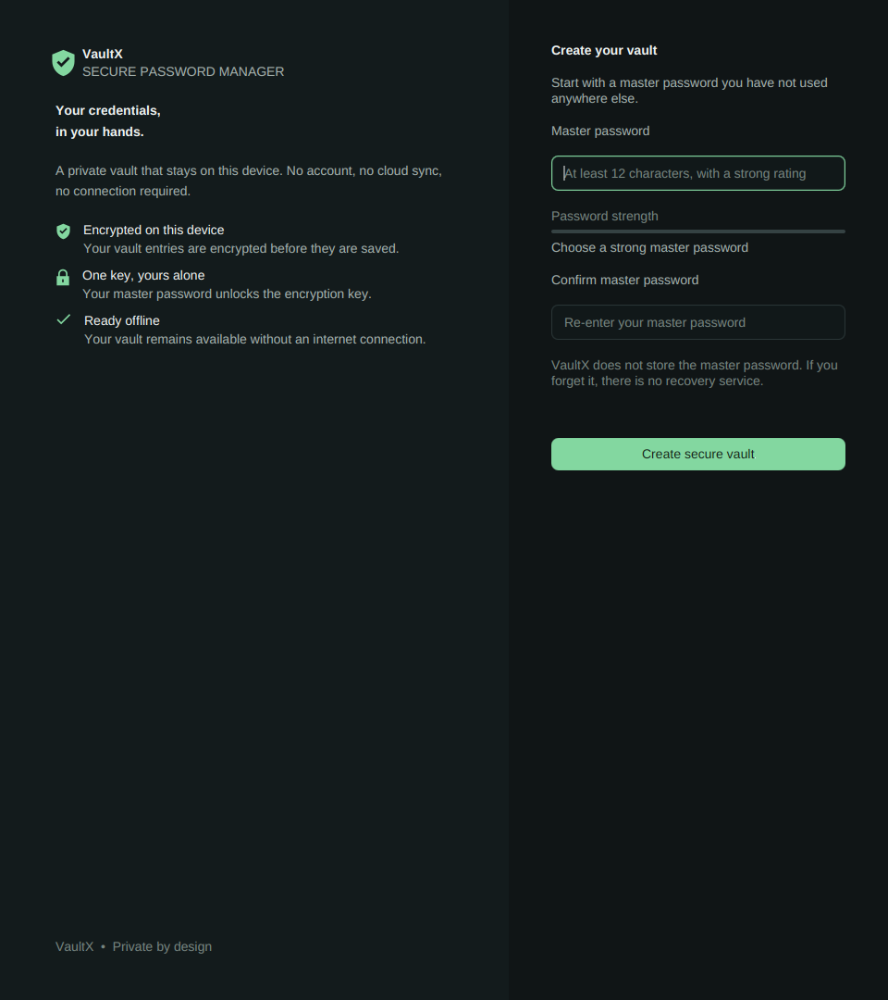
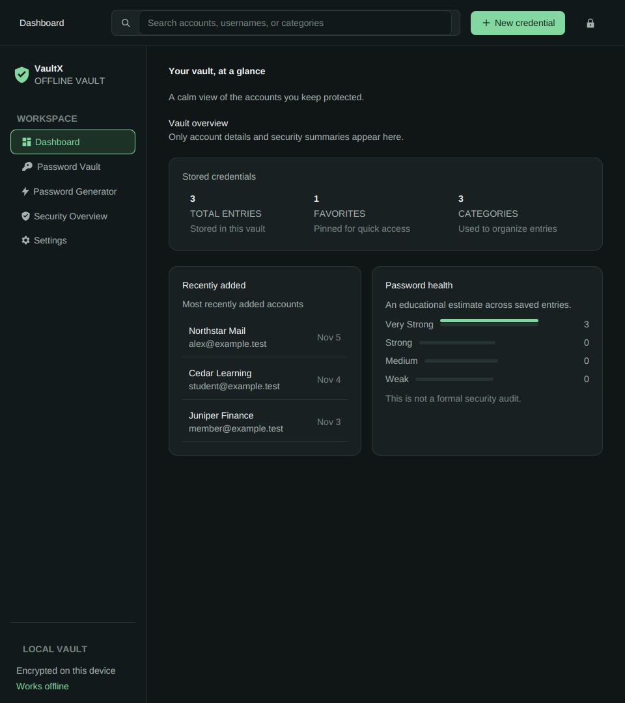
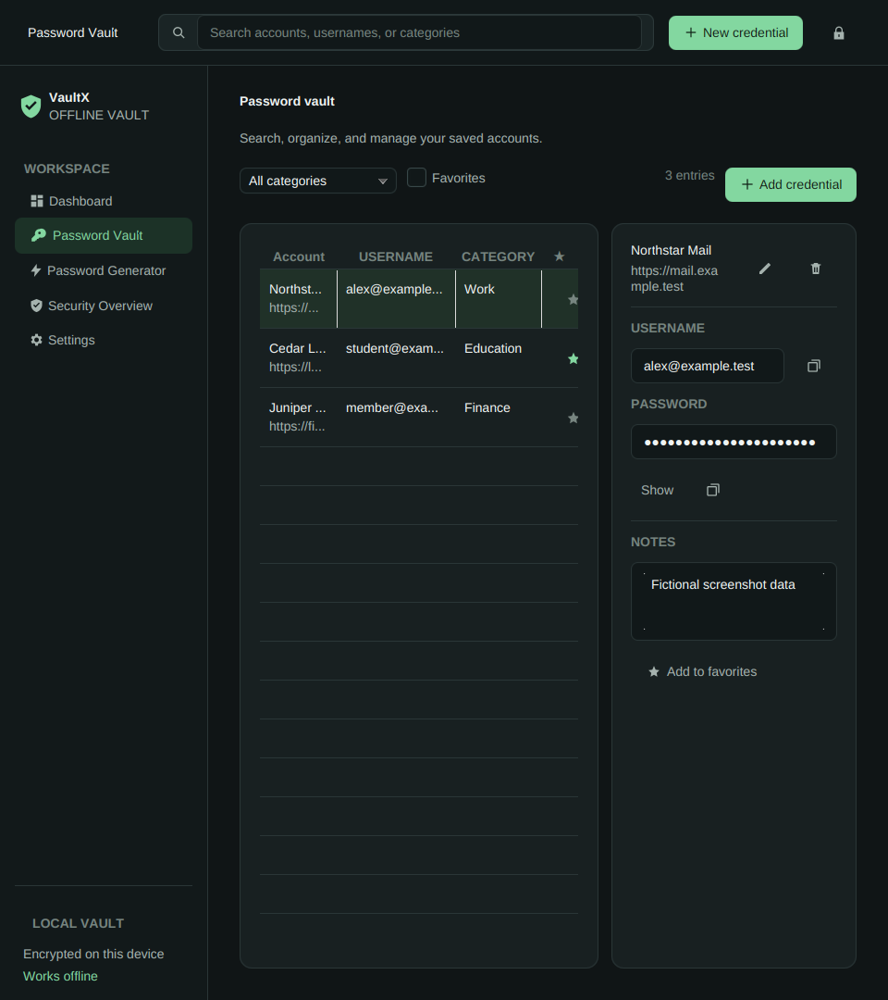
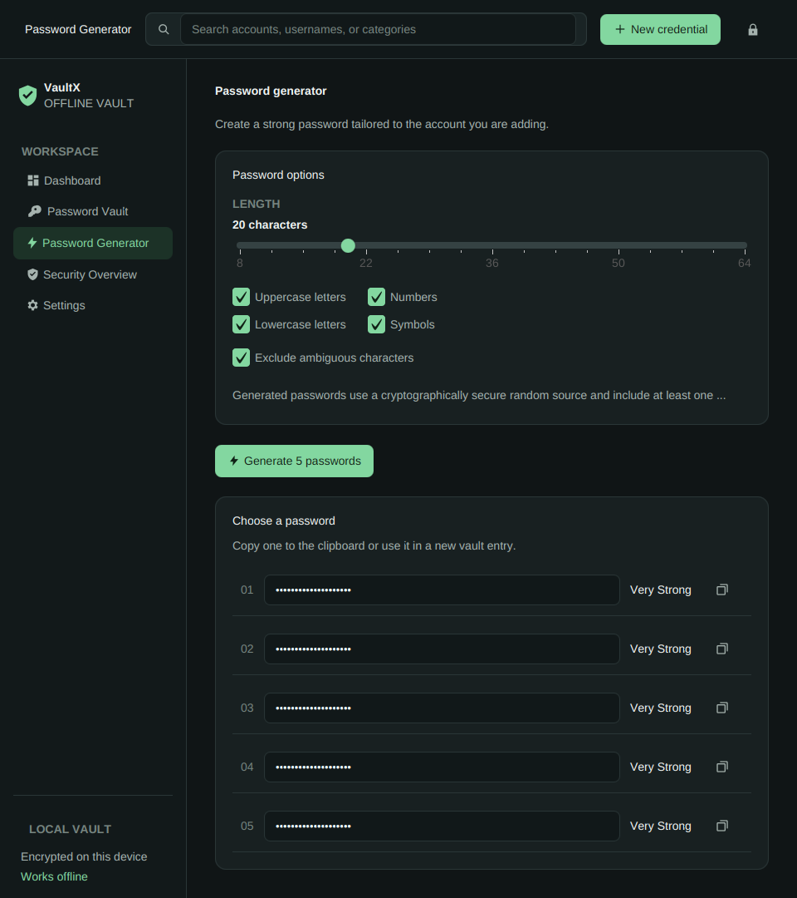
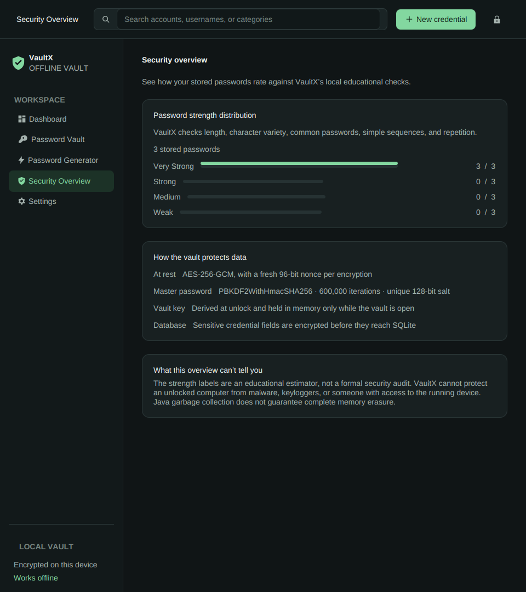
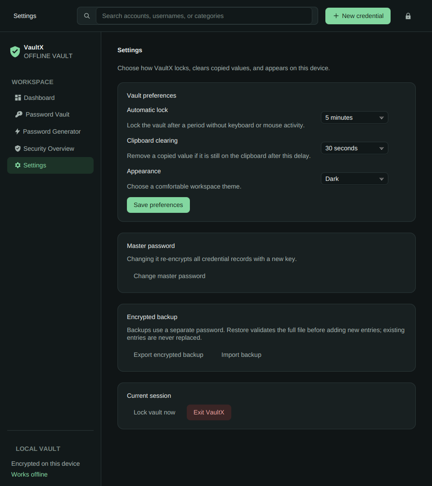

# VaultX — Secure Password Manager

## Academic project report

**Course:** Advanced Programming Practice  
**Implementation:** Java 21, JavaFX 21, Maven, SQLite, JDBC, JCA, JUnit 5  
**Project version:** 1.0.0

## 1. Abstract

VaultX is a local desktop application for storing and managing account credentials. It uses JavaFX for the user interface, SQLite for persistence, PBKDF2-HMAC-SHA256 for deriving authentication and vault key material, and AES-256-GCM to encrypt each complete credential record. It includes credential management, search and categories, a secure password generator, an educational strength estimator, inactivity lock, settings, and separate-password encrypted backup and restore. The system is designed to operate offline after installation. Automated tests exercise cryptographic integrity, authentication, database initialization, CRUD operations, generation, and backup behavior.

## 2. Introduction

People maintain many accounts, while reused or weak passwords create avoidable risk. A password manager can provide a single local place to organize unique credentials. The application must also protect data at rest, authenticate access, and offer an understandable workflow without depending on a cloud service.

## 3. Problem statement

Users need a simple offline way to create, organize, and retrieve credentials. Plaintext files and spreadsheets do not provide authenticated encryption or a safe workflow for locking and backup. The project addresses this by storing one encrypted record per account in a local database and deriving key material from a user-chosen master password.

## 4. Objectives

- Provide a desktop interface for credential lifecycle operations, search, filtering, and favorites.
- Encrypt all credential fields before database persistence.
- Verify a master password without storing it in plaintext.
- Generate random passwords and estimate strength locally.
- Support inactivity locking, clipboard clearing, encrypted backup, and restore.
- Demonstrate object-oriented Java, JavaFX, JDBC, exceptions, collections, streams, and background tasks.
- Provide repeatable tests and a self-contained Windows packaging path.

## 5. Existing system

Common informal approaches include memory, notes, spreadsheets, and browser-specific storage. They may be convenient but do not necessarily provide a portable encrypted export, explicit local vault, secure password generation, or one consistent workflow. This is a project analysis rather than a benchmark of commercial products.

## 6. Proposed system

VaultX stores its SQLite database on the local user profile. The application prompts for a master password, derives a 64-byte PBKDF2 result, and splits it into a verifier and an AES key. On successful unlock, the AES key lives in a session object until lock or exit. A credential is serialized to a binary record and encrypted with AES-GCM using a fresh nonce and the credential UUID as authenticated additional data. The whole record is encrypted so titles and usernames do not leak through database columns.

## 7. Technology stack

| Technology | Use |
| --- | --- |
| Java 21 | Language and runtime target |
| JavaFX 21 | Desktop UI controls and scene graph |
| Maven | Dependency pinning, build, test, and package orchestration |
| SQLite JDBC | Embedded local relational storage |
| JCA | PBKDF2-HMAC-SHA256, AES-GCM, and SecureRandom |
| JUnit 5 | Unit and service-level verification |
| SLF4J Simple | Minimal local logging without credential values |
| jpackage | Self-contained Windows MSI and app image |

Pinned versions are recorded in `pom.xml` and the README.

## 8. System architecture

The JavaFX views call services; services validate input, encrypt or decrypt records, and call repositories; repositories execute prepared JDBC statements against SQLite. Security primitives are isolated in `security/`, while `BackgroundTasks` runs operations that could block the JavaFX thread.

### UML class diagram

## 9. Use case diagram

## 10. Database design

The `vault_metadata` table holds one row with the random KDF salt, verifier, iteration count, schema version, and setup time. `credentials` stores a UUID, timestamps, a unique nonce, and ciphertext. The ciphertext contains every credential field, including category and favorite flag. `application_settings` stores only non-secret preferences. See [`database-schema.md`](database-schema.md) for SQL and field details.

## 11. Security implementation

PBKDF2-HMAC-SHA256 derives 64 bytes with 600,000 iterations and a random 16-byte salt. The first half is compared to the stored verifier with `MessageDigest.isEqual`; the second half is the AES-256 vault key. AES/GCM/NoPadding uses a 12-byte nonce and a 128-bit tag. A fresh `SecureRandom` nonce is generated for each operation; the credential UUID is authenticated as additional data. GCM rejects modified ciphertext and swapped record identifiers.

The application uses prepared statements, validates fields, keeps secrets out of logs, and clears sensitive arrays when practical. This cannot guarantee JVM heap erasure. The strength estimator is educational; VaultX is not audited and cannot protect against malware or host compromise. See [`security-design.md`](security-design.md).

## 12. Java concepts demonstrated

- Encapsulation: model fields and session key access are controlled through methods.
- Abstraction and separation of concerns: view, service, repository, and cryptography packages.
- Interfaces: screen lifecycle and `AutoCloseable` resource cleanup.
- Polymorphism: JavaFX controls and callbacks share base and functional interfaces.
- Exceptions: domain exceptions communicate validation, authentication, and storage failures.
- Collections and generics: lists, maps, sets, typed repositories, and test fixtures.
- JDBC and try-with-resources: prepared statements, result sets, and transactions.
- Lambdas and streams: UI callbacks and collection transformations.
- Concurrency: bounded background executor keeps costly KDF and persistence work away from the JavaFX application thread.
- File handling: database directory setup, temporary backup files, atomic replacement, and validation.

## 13. Testing

The JUnit 5 suite currently contains 20 tests. It verifies KDF repeatability and salt separation, setup and unlock behavior, password clearing, master-password change and record re-encryption, AES-GCM round trips, tamper and associated-data rejection, nonce uniqueness, schema creation, CRUD, encrypted columns, generator requirements, strength ratings, backup integrity, wrong backup passwords, and duplicate-ID handling. `mvn clean test package` passed on the available Linux host using a JDK 27 compiler targeting Java 21. The build used the Java 21 release API level; the host does not have a JDK 21 installation.

## 14. Screenshots

The images below were captured from the running JavaFX views with fictional records in a disposable database. They are not mockups and contain no user vault data. Generator output is masked in the image. See [`screenshots/README.md`](screenshots/README.md) for capture details.

## 15. Limitations

- The application has not received independent security review or penetration testing.
- Java cannot guarantee complete erasure of values from heap copies or system memory.
- A compromised host, keylogger, malware, screen capture, and clipboard readers are outside the protection boundary.
- Forgotten master or backup passwords cannot be recovered.
- Password strength is heuristic and uses no remote breach corpus.
- Windows installer creation is configured in CI but was not executed from this Linux session.
- Repository publication is pending because the available GitHub token is invalid.

## 16. Future scope

Possible future work includes independent security audit, schema migrations, richer import conflict review, native OS credential integration, accessibility testing, signed releases, broader operating system builds, and optional breach-list checks that preserve user consent and privacy.

## 17. Conclusion

VaultX delivers the requested core local-vault workflow and demonstrates a layered Java application with authenticated encryption, derivation, JDBC persistence, JavaFX screens, background work, tests, and a Windows packaging pipeline. The cryptographic tests pass locally. Native Windows artifact verification and GitHub publication remain pending external verification and are reported accurately rather than assumed.

## 18. References

1. Oracle, [Java Platform, Standard Edition Security Developer’s Guide, Release 21](https://docs.oracle.com/en/java/javase/21/security/), including the Java Cryptography Architecture.
2. OpenJFX, [JavaFX 21 Controls API](https://openjfx.io/javadoc/21/javafx.controls/javafx/scene/control/package-summary.html).
3. Xerial, [SQLite JDBC documentation](https://github.com/xerial/sqlite-jdbc/blob/master/README.adoc).
4. OWASP, [Password Storage Cheat Sheet](https://cheatsheetseries.owasp.org/cheatsheets/Password_Storage_Cheat_Sheet.html), PBKDF2 work-factor guidance.
5. NIST, [SP 800-38D: Recommendation for Block Cipher Modes of Operation: GCM and GMAC](https://csrc.nist.gov/pubs/sp/800/38/d/final).
6. Oracle, [JDK 21 Packaging Tool User’s Guide](https://docs.oracle.com/en/java/javase/21/jpackage/index.html).
7. Apache Maven, [POM Reference](https://maven.apache.org/pom.html).

Accessed 2026-11-05.

## 19. Demonstration materials

Use [`viva-preparation.md`](viva-preparation.md) for review questions and a five-minute product demonstration outline. A clean demonstration should use fictional accounts and a test master password that is never reused.
